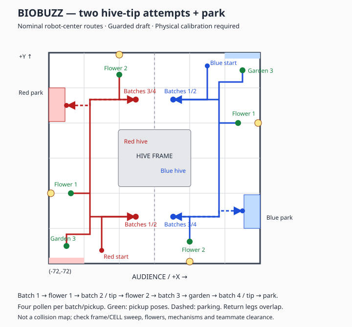

# BIOBUZZ: two hive-tip attempts, then park

`BiobuzzHiveAuto` implements the requested sequence using Pedro + Pinpoint for position and
Limelight for same-tag high-to-low transition evidence. It targets **your own alliance's hive**,
not both alliances' hives. It is a **commissioning draft listed on the Driver Station**, not a
match-ready routine. Listing does not bypass the calibration gates: the default configuration
still prevents movement and shooting.

The expanded sequence uses **four separate four-pollen shooting batches**:

**Drive to the raised cell → Limelight position fix → shoot 4 preloads → flower 1: collect 4 → shoot 4 / confirm first tip → flower 2: collect 4 →
opposite cell: shoot 4 → own garden: collect 4 → shoot 4 / confirm second tip → park.**

Eight pollen per tip is the team's requested tuning assumption, not a guaranteed manual threshold.
The first batch at each cell deliberately does not require a tip. The refill batch does.
Only your alliance's two flowers and garden are visited; no opponent-side pickup is programmed (G402).

## Route and start

The coordinate frame is the existing [BIOBUZZ field map](BIOBUZZ_FIELD_LOCATIONS.md):
robot center in inches; origin (0, 0) at the field CENTER, X and Y from −72 to +72;
+X right (blue side), +Y away from audience. Blue poses are red poses rotated 180°: (x, y) → (−x, −y).
The nominal hive frame footprint is about 49.46 x 38.95 inches centered on the field.
Shooting poses are team-chosen estimates, NOT FIRST-prescribed positions or verified trajectories.

| Stage | Red pose (X, Y, heading degrees) | Blue pose |
| --- | --- | --- |
| Required wall-contact start | (−36, −72 + half robot length, 90) | (36, 72 − half robot length, 270) |
| Clear wall | (−36, −51, 90) | (36, 51, 270) |
| First approach | (−36, −40, 90) | (36, 40, 270) |
| Shooting batches 1 and 2: initially raised cell (Limelight fix here) | (−12.75, −40, 90) | (12.75, 40, 270) |
| Flower 1 intake approach → pickup | (−49, −24, 180) → (−57, −24, 180) | (49, 24, 0) → (57, 24, 0) |
| Flower 2 intake approach → pickup | (−24, 49, 90) → (−24, 57, 90) | (24, −49, 270) → (24, −57, 270) |
| Shooting batches 3 and 4: opposite cell | (−12.75, 40, 270) | (12.75, −40, 90) |
| Own garden intake approach → pickup | (−60, −52, 270) → (−60, −60, 270) | (60, 52, 90) → (60, 60, 90) |
| Outside transit corridor | X = −44 | X = 44 |
| Nominal loading-zone park | (−60, 36, 180) | (60, −36, 0) |

`HiveAutoRoute.approach(Stage)` contains every intermediate transit waypoint. Each pickup's
last eight inches runs at reduced drive power with the intake on, followed by a bounded dwell.
The route backs away from wall pickups before rotating, and retreats to the outside corridor
before changing hive sides. Flower centers are nominally (−72,−24)/(−24,72) for red and
(72,24)/(24,−72) for blue; pickup poses above refer to the robot center, not the flower itself.
The garden approach assumes a sufficiently wide, floor-level intake can collect its four staged pollen.
Intake reach, lower-opening access, contact clearance and garden sweep require physical verification.

Parking requires the robot to be **at least partially in its loading zone**, not entirely inside it
(TU06 section 10.5.4, page 90). These park poses overlap the nominal loading-zone rectangles with
an 18-inch footprint. Measure the taped boundaries and actual footprint before enabling.
Only these two starts are currently supported; INIT d-pad left/right selects red/blue and a fresh
A confirms the corresponding physical placement. After Play, no gamepad commands are read;
use Driver Station STOP to abort and enable its 30-second AUTO timer (G401).

## Limelight position fix in front of the raised cell

Placement at the wall is never perfect, so the start pose is only an assumption. After the first
approach the robot stops at the batch 1/2 shooting pose (where it THINKS it is), then:

1. Holds that pose and reads `RELOCALIZE_FRAMES` (default 5) distinct, fresh Limelight frames
   within `RELOCALIZE_TIMEOUT_SECONDS` (default 1 s).
2. For every visible tag whose field position is listed in `RED_HIVE_TAGS` / `BLUE_HIVE_TAGS`,
   computes where the robot center must be from the tag's measured forward/left offset and the
   Pinpoint heading. Several tags in one frame are averaged.
3. Averages "vision minus odometry" over the frames. If the frames agree within
   `RELOCALIZE_MAX_SPREAD_INCHES` (2 in) and the correction is at most
   `RELOCALIZE_MAX_CORRECTION_INCHES` (8 in), Pedro/Pinpoint X/Y is overwritten. Heading is kept:
   the Pinpoint IMU heading is more reliable than a single-tag angle.
4. Re-drives to the shooting pose, now using the corrected position. Every later leg (pickups,
   opposite cell, park) runs from the corrected values.

If no tag positions are measured, the Limelight is missing, too few frames arrive, the frames
disagree, or the correction is implausibly large, odometry is left **unchanged** and the route
continues on it. Telemetry line `Limelight Position Fix` always says which happened, with dX/dY.
The Limelight is read (not the shooter) in `DRY_RUN` too, so the fix can be commissioned first.

### Measuring the hive tag positions (required once)

The fix is only as good as the tag map. The defaults are `NaN` (not measured), which skips it.
Measure with the hive in its **starting/staged position**: the tags move when it tips, and the fix
runs before the first shot.

1. Configure the Limelight robot-space camera transform (position and pitch) first.
2. Place the robot EXACTLY at the red batch 1/2 pose (−12.75, −40), facing +Y (away from the
   audience), using a tape measure from the walls (the wall is at −72).
3. Run `Test: Limelight` and read each visible tag's **forward** and **left**.
4. Facing +Y the math is simple: **tag X = −12.75 − left**, **tag Y = −40 + forward**.
   Enter `{id, X, Y}` rows in `HiveAutoConfig.RED_HIVE_TAGS`.
5. Repeat for blue at (12.75, 40) facing −Y: **tag X = 12.75 + left**, **tag Y = 40 − forward**,
   into `BLUE_HIVE_TAGS`.
6. Check: run the auto in `DRY_RUN` from a deliberately misplaced start (e.g. 2 in off along the
   wall). `Limelight Position Fix` should report APPLIED with about that dX/dY.

During the auto, each visible tag also shows "field XY" computed from the current pose, which
should match the configured table once the fix has been applied.

## Shooting and confirmation

1. Arrive and hold the configured shooting pose using Pinpoint.
2. Require three distinct Limelight frames showing the SAME tag high for at least 0.25 seconds.
3. Spin `Shoot1` / `Shoot2` to their configured RPMs; require both within 150 RPM for 0.25 seconds.
4. Pulse the explicitly selected feeder four times per batch, with flywheel readiness checks and pauses.
   A complete pulse counts as one **expected** pollen only under verified timing calibration.
5. Stop feeding immediately if low-height evidence appears, visibility is lost, RPM drops, or pose drifts.
6. After batches 1/3, allow a completed four-pulse batch without a tip so the robot can collect the refill.
   After batches 2/4, require the same tag low in three distinct frames over at least 0.35 seconds.
   The same detector/tag identity is retained between the two batches for each cell.

Unexpected first-batch tipping stops the planned scoring sequence rather than firing into a low cell.
An interrupted pulse or pickup makes expected inventory UNKNOWN and blocks all further pickups.
The software refuses to start any pickup unless expected inventory is empty, respecting G407's
four-element carrying limit. This is not a sensor-backed guarantee: timing alone cannot prove the
robot holds four pollen, has released four pollen, or has scored them successfully.

Expected tag clusters from Figure 9-17 (page 77): red first 34–37 then 30–33;
blue first 42–45 then 38–41. Initial raised sides follow the staging diagram (page 83).
Tag disappearance, a different tag, repeated polling of one frame, or elapsed shooting time
does NOT count as a tip. The tag-height signal is a **vision proxy**, not proof of official scoring:
section 10.5.1 requires the hive's opposite damper to contact the frame.

Drive/heading hold, Limelight polling and shooting are updated in one nonblocking loop. There are
no `sleep()` calls, so waiting for flywheel speed or a hive transition does not pause movement updates.
Apart from the one position fix above, Limelight never changes the Pinpoint position. There is no automatic ballistic solver or vision steering;
the shooting pose, heading, flywheel direction/RPM and feeder must be physically calibrated.

## Commissioning gates — do not skip

In `config/HiveAutoConfig.java`:

- Keep `DRY_RUN = true` initially. No shooter, feeder, intake or Limelight is initialized in dry-run mode;
  pickups/shots are simulated in the inventory model and no tip successes are claimed. The route
  still drives to pickup poses, so physical route/clearance verification remains mandatory.
- Check all paths, actual robot dimensions, extended mechanisms, teammate clearance, frame/CELL sweep,
  flowers, wall departure and parking. Set `ROUTE_VERIFIED = true` only after verification.
- Build and deploy to the Robot Controller to see `BIOBUZZ: Two Hive Tips + Park` in the AUTO list.
  It has no `@Disabled` annotation; route verification remains required before even a dry-run move.
- Use `FEEDER = INTAKE` for the currently supported live feeder; default `NONE`
  deliberately blocks live operation. `SERVO` is now rejected because `servoMotor`
  is the positional Limelight pan mount, not a pollen feeder.
  Only the selected feeder is used during shooting. The `intake` motor is independently commanded
  during collection; if it also feeds the shooter, both roles share the same hardware instance.
  Shooter and feeder stay off during pickups. Confirm signed powers and `FEED_PULSE_SECONDS` safely.
- Calibrate `PICKUP_INTAKE_POWER`, `PICKUP_DRIVE_POWER`, `PICKUP_HOLD_SECONDS`, all pickup positions
  and intake reach. Set `PICKUPS_VERIFIED = true` only after testing both flowers and garden.
- No pollen-counting sensor is configured. Default `TIMED_POLLEN_COUNTING_VERIFIED = false` blocks
  live operation. Enable only after establishing one pollen per feed pulse and four per timed pickup.
  For reliable measured counts and missed-shot detection, add appropriate sensors rather than assuming
  a completed timer proves collection/scoring. Expected count and UNKNOWN status appear in telemetry.
- Tune both `SHOOT_RPM_*` and flywheel direction to launch INTO an **upward-facing opening**.
  G417 prohibits intentionally tipping by hitting exterior surfaces or physically manipulating the hive.
  The AprilTags themselves are not the shooting target.
- The lens is currently 14.8 inches above the floor. Configure its measured translation AND mounting
  pitch in Limelight. `ROBOT_ORIGIN_HEIGHT_INCHES` is the field height of the configured robot-space
  origin, NOT necessarily lens height. Calibrate the provisional LOW/HIGH height bands in both states.
- Configure Limelight pipeline 0 for 36h11 tags of 3.25 inches. Confirm robot-space ranges, full-tag
  visibility and same-tag transition detection at BOTH shooting poses. Low-face occlusion can prevent
  confirmation; do not replace lost visibility with assumed success.
- Four pollen are preloaded per robot (page 84). Each own-side flower starts with four pollen and
  the own garden with four (page 83): 4 + 4 + 4 + 4 = 16 available for this routine. Coordinate with
  your teammate so these supplies are not removed before the programmed pickups.
- Only then set `SHOOTING_AND_CAMERA_VERIFIED = true` and `DRY_RUN = false` for live testing.

## Failure and time handling

Each drive leg has a 5-second timeout. Each four-shot batch has a 6-second timeout.
Pickup dwell defaults to 1.5 seconds after the slow intake creep.
Scoring is interrupted at 21 seconds to reserve 7 seconds of the 28-second software budget for parking.
A failed batch, interrupted pickup or missing required tip skips remaining scoring and tries parking
via the outside corridor. Lack of a tip after batches 1/3 is intentional and is NOT a failure.
A Pinpoint fault, movement timeout or STOP stops the routine rather than attempting blind recovery.
All initialized mechanisms and drive motors stop on every exit, including exceptions.
Time reserve does not guarantee parking: measured speed and total route duration must fit the budget.
This expanded route is substantially longer, especially the garden round trip. It may park before
completing the full requested sequence at the current conservative speed; do not extend AUTO past
30 seconds. Optimize/test motion and mechanism timing before using it in a match.
Endpoint bounds checks are not obstacle avoidance; there is no dynamic collision or opponent detection.

## Files and tests

- `opmodes/BiobuzzHiveAuto.java`: hardware orchestration, INIT selection, motion and parking.
- `navigation/HiveAutoRoute.java`: nominal mirrored red/blue waypoints and tag clusters.
- `localization/HiveTipDetector.java`: fresh-frame same-tag transition evidence.
- `localization/HiveTagRelocalizer.java`: averaged X/Y fix from measured hive tag positions.
- `control/HiveShotController.java`: bounded nonblocking flywheel/feed/wait states.
- `control/PollenBatchInventory.java`: expected four-element inventory and interruption handling.
- `config/HiveAutoConfig.java`: explicit commissioning gates and provisional tunables.
- `localization/AprilTagTracker.java`: exposes the SDK Limelight frame timestamp.

Unit tests cover mirrored routes, endpoints, outer-corridor recovery, missing/wrong/repeated tags,
high-to-low confirmation, RPM/pose/connection interlocks, four-pulse batches with/without tip requirements,
16-pollen sequencing, refill limits, interrupted inventory, pickup geometry and failure timeouts.
Sampled nominal segments are checked against field bounds, own-half footprint and a conservative
expanded frame rectangle, not actual field CAD or moving hive geometry.
They do not simulate trajectories, pollen physics, damper contact or physical field collisions.
