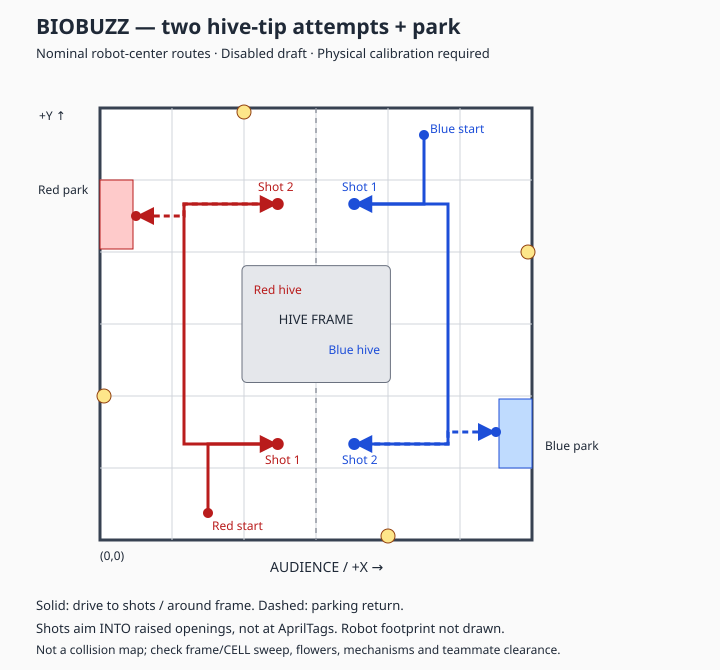

# BIOBUZZ: two hive-tip attempts, then park

`BiobuzzHiveAuto` implements the requested sequence using Pedro + Pinpoint for position and
Limelight for same-tag high-to-low transition evidence. It targets **your own alliance's hive**,
not both alliances' hives. It is a **disabled commissioning draft**, not a match-ready routine.

## Route and start

The coordinate frame is the existing [BIOBUZZ field map](BIOBUZZ_FIELD_LOCATIONS.md):
robot center in inches; origin audience-left; +X right, +Y away from audience.
The nominal hive frame footprint is about 49.46 x 38.95 inches centered on the field.
Shooting poses are team-chosen estimates, NOT FIRST-prescribed positions or verified trajectories.

| Stage | Red pose (X, Y, heading degrees) | Blue pose |
| --- | --- | --- |
| Required wall-contact start | (36, half robot length, 90) | (108, 144 − half robot length, 270) |
| Clear wall | (36, 21, 90) | (108, 123, 270) |
| First approach | (36, 32, 90) | (108, 112, 270) |
| First shot: initially raised cell | (59.25, 32, 90) | (84.75, 112, 270) |
| Retreat to outside corridor | (28, 32, 90) | (116, 112, 270) |
| Travel around frame | (28, 112, 90) | (116, 32, 270) |
| Second shot: opposite cell | (59.25, 112, 270) | (84.75, 32, 90) |
| Retreat, approach parking | (28, 112, 270), (28, 108, 180) | (116, 32, 90), (116, 36, 0) |
| Nominal loading-zone park | (12, 108, 180) | (132, 36, 0) |

Parking requires the robot to be **at least partially in its loading zone**, not entirely inside it
(TU06 section 10.5.4, page 90). These park poses overlap the nominal loading-zone rectangles with
an 18-inch footprint. Measure the taped boundaries and actual footprint before enabling.
Only these two starts are currently supported; INIT d-pad left/right selects red/blue and a fresh
A confirms the corresponding physical placement. After Play, no gamepad commands are read;
use Driver Station STOP to abort and enable its 30-second AUTO timer (G401).

## Shooting and confirmation

1. Arrive and hold the configured shooting pose using Pinpoint.
2. Require three distinct Limelight frames showing the SAME tag high for at least 0.25 seconds.
3. Spin `Shoot1` / `Shoot2` to their configured RPMs; require both within 150 RPM for 0.25 seconds.
4. Pulse the explicitly selected feeder, then stop and wait. At most two commanded pulses per side.
5. Stop feeding immediately if low-height evidence appears, visibility is lost, RPM drops, or pose drifts.
6. Require the same tag low in three distinct frames over at least 0.35 seconds before advancing.

Expected tag clusters from Figure 9-17 (page 77): red first 34–37 then 30–33;
blue first 42–45 then 38–41. Initial raised sides follow the staging diagram (page 83).
Tag disappearance, a different tag, repeated polling of one frame, or elapsed shooting time
does NOT count as a tip. The tag-height signal is a **vision proxy**, not proof of official scoring:
section 10.5.1 requires the hive's opposite damper to contact the frame.

Drive/heading hold, Limelight polling and shooting are updated in one nonblocking loop. There are
no `sleep()` calls, so waiting for flywheel speed or a hive transition does not pause movement updates.
Limelight never changes the Pinpoint position. There is no automatic ballistic solver or vision steering;
the shooting pose, heading, flywheel direction/RPM and feeder must be physically calibrated.

## Commissioning gates — do not skip

In `config/HiveAutoConfig.java`:

- Keep `DRY_RUN = true` initially. No shooter, feeder, intake or Limelight is initialized in dry-run mode;
  shots are skipped and no tip successes are claimed.
- Check all paths, actual robot dimensions, extended mechanisms, teammate clearance, frame/CELL sweep,
  flowers, wall departure and parking. Set `ROUTE_VERIFIED = true` only after verification.
- Remove `@Disabled` from `BiobuzzHiveAuto` when ready to test the verified route.
- Determine whether `FEEDER` is `INTAKE` or `SERVO`; default `NONE` deliberately blocks live operation.
  Only the selected feeder is commanded. Confirm signed `FEED_POWER` and `FEED_PULSE_SECONDS` safely.
- Tune both `SHOOT_RPM_*` and flywheel direction to launch INTO an **upward-facing opening**.
  G417 prohibits intentionally tipping by hitting exterior surfaces or physically manipulating the hive.
  The AprilTags themselves are not the shooting target.
- The lens is currently 14.8 inches above the floor. Configure its measured translation AND mounting
  pitch in Limelight. `ROBOT_ORIGIN_HEIGHT_INCHES` is the field height of the configured robot-space
  origin, NOT necessarily lens height. Calibrate the provisional LOW/HIGH height bands in both states.
- Configure Limelight pipeline 0 for 36h11 tags of 3.25 inches. Confirm robot-space ranges, full-tag
  visibility and same-tag transition detection at BOTH shooting poses. Low-face occlusion can prevent
  confirmation; do not replace lost visibility with assumed success.
- Four pollen are preloaded per robot (page 84). Two pulses per side are NOT measured ball counts,
  and the manual does not promise two pollen will tip a hive. Verify supply and tipping experimentally;
  extra collection/reloading is not implemented.
- Only then set `SHOOTING_AND_CAMERA_VERIFIED = true` and `DRY_RUN = false` for live testing.

## Failure and time handling

Each drive leg has a 5-second timeout. Each shooting attempt has a 6-second timeout.
Scoring is interrupted at 21 seconds to reserve 7 seconds of the 28-second software budget for parking.
A failed/unconfirmed first shot skips the second attempt and tries parking via the outside corridor.
A Pinpoint fault, movement timeout or STOP stops the routine rather than attempting blind recovery.
All initialized mechanisms and drive motors stop on every exit, including exceptions.
Time reserve does not guarantee parking: measured speed and total route duration must fit the budget.
Endpoint bounds checks are not obstacle avoidance; there is no dynamic collision or opponent detection.

## Files and tests

- `opmodes/BiobuzzHiveAuto.java`: hardware orchestration, INIT selection, motion and parking.
- `navigation/HiveAutoRoute.java`: nominal mirrored red/blue waypoints and tag clusters.
- `localization/HiveTipDetector.java`: fresh-frame same-tag transition evidence.
- `control/HiveShotController.java`: bounded nonblocking flywheel/feed/wait states.
- `config/HiveAutoConfig.java`: explicit commissioning gates and provisional tunables.
- `localization/AprilTagTracker.java`: exposes the SDK Limelight frame timestamp.

Unit tests cover mirrored routes, endpoints, outer-corridor recovery, missing/wrong/repeated tags,
high-to-low confirmation, RPM/pose/connection interlocks, feed limits and failure timeouts.
They do not simulate trajectories, pollen physics, damper contact or physical field collisions.
